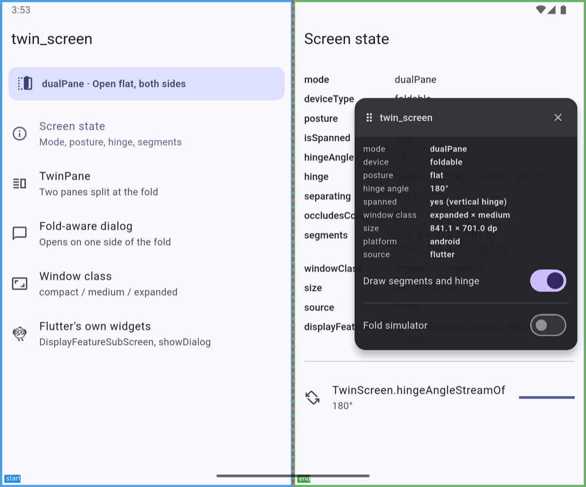
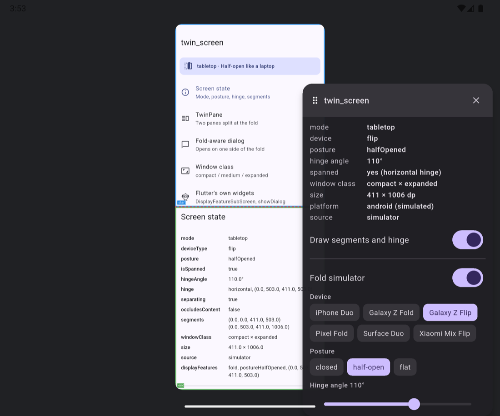

# Debug overlay and fold simulator

Most developers do not own a foldable, and those who do rarely own all of
them. `TwinDebugOverlay` lets you see what `twin_screen` sees, and simulates
six real devices on any phone, simulator, emulator, desktop or browser.

```dart
void main() {
  runApp(
    const TwinScreenScope(
      child: TwinDebugOverlay(child: MyApp()),
    ),
  );
}
```

Place it inside `TwinScreenScope` and above your `MaterialApp`.



## The info panel

A small round button floats over your app. Drag it anywhere. Tap it to open
the panel, which shows the live state:

| Row | Meaning |
|---|---|
| mode | The combined `TwinScreenMode` |
| device | `deviceType` |
| posture | `posture` |
| hinge angle | Degrees, or `–` without a sensor |
| spanned | Whether the window crosses the fold, and the fold's axis |
| window class | Width × height class |
| size | The window size in dp |
| platform | The running platform, or the simulated one |
| source | `flutter`, `plugin`, `simulator` or `fallback` |

Drag the panel by its header. Close it with the × button.

## Drawing the fold

With **Draw segments and hinge** on, the overlay outlines:

- the **start segment** in blue and the **end segment** in green, each
  labelled;
- the **fold** as a dashed red line, and a **physical hinge** as a red area;
- **cutouts** (camera holes) in orange.

The drawing ignores touches, so the app stays fully usable.

## The fold simulator

Turn on **Fold simulator**. The app is rendered at the logical size of the
chosen device, scaled to fit your screen, with a faked `MediaQuery` (size,
padding, display features) and a faked platform report (device type, posture,
hinge angle, rotation). Every `twin_screen` API and every Flutter fold-aware
widget in your app sees the simulated device.



Controls:

| Control | Options |
|---|---|
| Device | iPhone Duo, Galaxy Z Fold, Galaxy Z Flip, Pixel Fold, Surface Duo, Xiaomi Mix Flip |
| Posture | closed (cover screen), half-open, flat. Devices without a cover screen cannot close. |
| Hinge angle | 0–180°. Moving it also updates the posture (< 30° closed, > 150° flat). |
| Orientation | portrait or landscape. Rotating moves the fold to the other axis. |
| App window | both sides, start only, end only (the app shares the screen with another app) |

Your app keeps its state (scroll positions, navigation, text input) while you
switch between devices and postures, and when you turn the simulator off.

### The presets

| Preset | Kind | Inner screen (natural) | Fold | Cover screen |
|---|---|---|---|---|
| iPhone Duo | book | 951 × 669 pt | vertical | 386 × 678 pt app window |
| Galaxy Z Fold | book | 707 × 823 dp | vertical | 369 × 905 dp |
| Galaxy Z Flip | flip | 411 × 1006 dp | horizontal | 360 × 374 dp |
| Pixel Fold | book | 841 × 701 dp | vertical | 411 × 797 dp |
| Surface Duo | two panels | 1114 × 720 dp | vertical, 34 dp hinge | none |
| Xiaomi Mix Flip | flip | 445 × 1059 dp | horizontal | 439 × 506 dp |

The iPhone Duo sizes come from the iOS 27.1 simulator. Its cover display is
466 pt wide, but the right 80 pt hold the camera and the status bar, so apps
get a 386 pt-wide window. The Android sizes come from public specifications
and emulator profiles, rounded. They are close enough to test layouts, not
exact for every model year.

Your own device:

```dart
const myFoldable = TwinDevicePreset(
  name: 'My foldable',
  deviceType: TwinDeviceType.foldable,
  innerSize: Size(720, 820),
  innerHingeAxis: TwinHingeAxis.vertical,
  coverSize: Size(380, 860),
);

TwinDebugOverlay(
  presets: [...TwinDevicePreset.all, myFoldable],
  child: const MyApp(),
)
```

## Driving the simulator from code

Pass a `TwinSimulatorController` to control the simulator from your own UI, a
keyboard shortcut or a test:

```dart
final controller = TwinSimulatorController();

TwinDebugOverlay(controller: controller, child: const MyApp());

// Later:
controller.simulate(
  preset: TwinDevicePreset.galaxyZFold,
  posture: TwinPosture.halfOpened,
  orientation: Orientation.landscape,
);
controller.hingeAngle = 120;
controller.span = TwinSimulatedSpan.end;
controller.stop();
```

`simulate` turns the simulator on and sets everything in one notification.
Each property can also be set on its own.

## Options

```dart
TwinDebugOverlay(
  enabled: !kReleaseMode,      // default: on in debug and profile, off in release
  controller: null,            // your own TwinSimulatorController
  presets: TwinDevicePreset.all,
  drawFeatures: true,          // outline segments, hinge and cutouts
  showPanel: true,             // the round button and panel
  child: const MyApp(),
)
```

When `enabled` is false the overlay returns your app unchanged, with no cost.
Set `enabled: true` to keep it in a release build, for example for internal
testers. Set `showPanel: false` to drive the simulator from code only.

## Limits

- The simulator fakes what Flutter sees. It does not emulate platform
  behaviour, such as Android moving your activity to the cover display.
- Keyboards and system bars are not simulated; the safe area uses typical
  values for each device.
- The panel is laid out in your real screen, so on a small phone it can
  cover part of the simulated device. Drag it aside, or close it.

## Related

- [Testing](testing.md): the same presets in widget tests.
- [Platforms](platforms.md): setting up real emulators.
